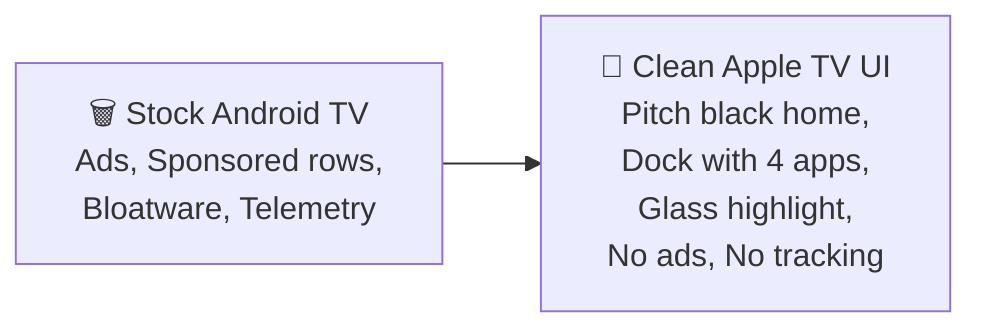

# 🍎 Transform Your Sony Bravia KD-49X8200E into an Apple TV

**A complete guide using [CleanYourTV](https://github.com/Gathin23/cleanyourtv) — prepared for your winter vacation trip to Vijayawada.**

---

## Table of Contents
1. [Your TV at a Glance](#your-tv-at-a-glance)
2. [What You'll Get](#what-youll-get)
3. [Prerequisites — Set Up Before You Travel](#prerequisites)
4. [Phase 1: Prepare the TV (On the TV Remote)](#phase-1-prepare-the-tv)
5. [Phase 2: Connect via ADB (On Your Laptop)](#phase-2-connect-via-adb)
6. [Phase 3: Back Up Everything](#phase-3-back-up-everything)
7. [Phase 4: Debloat — Remove the Junk](#phase-4-debloat)
8. [Phase 5: Build & Install the Apple TV Launcher](#phase-5-build--install-the-launcher)
9. [Phase 6: Customize the Dock & Config](#phase-6-customize)
10. [Phase 7: Optional Extras](#phase-7-optional-extras)
11. [Phase 8: Verify & Lock Down](#phase-8-verify--lock-down)
12. [How to Restore Everything](#how-to-restore)
13. [After a Firmware Update](#after-a-firmware-update)
14. [Key Files in the Repo](#key-files-in-the-repo)
15. [Important Warnings](#important-warnings)

---

## Your TV at a Glance

| Property | Value |
|---|---|
| **Model** | Sony Bravia KD-49X8200E |
| **Year** | 2017 |
| **Platform** | Android TV (MediaTek chipset, BRAVIA_ATV2 family) |
| **Likely Android version** | Android TV 8.0 or 9 (Oreo/Pie) |
| **RAM** | 2 GB |
| **Stock launcher** | `com.google.android.tvlauncher` or `com.google.android.leanbacklauncher` |
| **Input app** | `com.sony.dtv.tvx` (handles HDMI + Live TV) |
| **Closest tested models in repo** | Sony XBR-X900E, Sony KD-55XE8596 — same generation Sony BRAVIA_ATV2 platform |

> [!NOTE]
> Your KD-49X8200E is the same BRAVIA_ATV2 / MediaTek platform as the tested Sony XBR-X900E and KD-55XE8596. The bloatware packages will be nearly identical. The debloat list below is based on those tested lists, but the AI assistant will **discover and verify** the exact packages on your TV.

---

## What You'll Get



| Feature | Description |
|---|---|
| **Pitch-black home screen** | A dock row at the bottom in a rounded band (like Apple TV) |
| **Top shelf** | Focused app's name in large type + ambient glow in its color |
| **App grid** | Scrolls up on Down press, same number of columns |
| **Glass highlight** | One floating translucent highlight that springs between tiles |
| **Frosted pills** | Inputs, Wi-Fi (shows network name), Settings — top right |
| **Clock & greeting** | Large thin clock + date in the Outfit typeface, top left |
| **~572 KB launcher** | No internet permission, no background services, no blur |

---

## Prerequisites

> [!IMPORTANT]
> **Set these up on your MacBook at IIT Madras BEFORE going home.** The actual transformation requires being on the **same Wi-Fi** as the TV (Jio Fiber at home).

### On Your MacBook (do this now at IITM):

```bash
# 1. Clone the repo (already done in your project folder)
cd ~/Desktop/Projects/renovate_your_TV/cleanyourtv

# 2. Set up Python venv for the tools
python3 -m venv tools/venv
tools/venv/bin/pip install -r tools/requirements.txt

# 3. Install JDK 17 (needed to build the launcher)
brew install openjdk@17

# 4. Install Android SDK tools
brew install android-commandlinetools
sdkmanager "platforms;android-34" "build-tools;34.0.0"
```

### What to Pack:
- ✅ Your MacBook with the repo cloned
- ✅ Python venv set up and working
- ✅ JDK 17 installed
- ✅ Android SDK platform 34 + build-tools 34 installed

---

## Phase 1: Prepare the TV

**🏠 At home in Vijayawada, on your Sony Bravia with the remote:**

### Step 1: Enable Developer Mode

1. Go to **Settings** → **Device Preferences** → **About**
2. Scroll down to **Build** and press **OK** on it **7 times**
3. You'll see: _"You are now a developer!"_

### Step 2: Enable ADB Debugging

1. Go back to **Settings** → **Device Preferences** → **Developer options**
2. Turn on **USB debugging** → ON
3. If you see **Network debugging** or **ADB debugging**, turn that ON too
4. Keep the TV on and connected to **Jio Fiber Wi-Fi**

### Step 3: Note the TV's IP Address

1. Go to **Settings** → **Network & Internet** → **your Wi-Fi network**
2. Note down the IP address (e.g., `192.168.29.XXX` — Jio Fiber typically uses this range)

---

## Phase 2: Connect via ADB

**💻 On your MacBook, connected to the SAME Jio Fiber Wi-Fi:**

```bash
cd ~/Desktop/Projects/renovate_your_TV/cleanyourtv

# Set the TV's IP address (replace with your TV's actual IP)
export TV_HOST=192.168.29.XXX

# Test the connection
tools/venv/bin/python -I tools/tv.py --probe
```

> [!IMPORTANT]
> **When you run this, the TV will show "Allow USB debugging?" on screen. Walk over and press ALLOW on the TV remote.** Check "Always allow from this computer" if offered.

If the stock `adb` binary gives "No route to host" on macOS (a Local Network privacy issue), `tools/tv.py` uses a pure-Python ADB client that bypasses this — it should work out of the box.

### Verify connection:
```bash
# List all packages on the TV
tools/venv/bin/python -I tools/tv.py 'pm list packages' > backup/packages-all.txt

# Check model info
tools/venv/bin/python -I tools/tv.py 'getprop ro.product.model'
tools/venv/bin/python -I tools/tv.py 'getprop ro.build.version.sdk'
```

---

## Phase 3: Back Up Everything

**Do this BEFORE changing anything!**

```bash
mkdir -p backup

# Save the full package list
tools/venv/bin/python -I tools/tv.py 'pm list packages' > backup/packages-all.txt

# Save already-disabled packages
tools/venv/bin/python -I tools/tv.py 'pm list packages -d' > backup/packages-disabled.txt

# Save system properties
tools/venv/bin/python -I tools/tv.py 'getprop' > backup/getprop.txt

# Save all settings
tools/venv/bin/python -I tools/tv.py 'settings list global' > backup/settings-global.txt
tools/venv/bin/python -I tools/tv.py 'settings list secure' > backup/settings-secure.txt
tools/venv/bin/python -I tools/tv.py 'settings list system' > backup/settings-system.txt

# Take a "before" screenshot
tools/venv/bin/python -I tools/tv.py --screenshot shots/00-before-stock.png
```

---

## Phase 4: Debloat

### The Sony Bravia KD-49X8200E Debloat List

Based on the tested lists from the same Sony BRAVIA_ATV2 platform, here is a debloat list tailored for your TV. Create this file:

**File: `examples/sony-kd-49x8200e/debloat.txt`**

```
# Sony Bravia KD-49X8200E (2017, BRAVIA_ATV2, MediaTek), India
# Android TV 8/9, Sony firmware
#
# Apply:   TV_HOST=<tv ip> tools/disable.sh examples/sony-kd-49x8200e/debloat.txt
# Undo:    TV_HOST=<tv ip> tools/restore.sh examples/sony-kd-49x8200e/debloat.txt
# Everything is DISABLED, not uninstalled. Comment out any line you want to keep.
#
# Stock launcher: com.google.android.tvlauncher (restore.sh's default).
# Live TV / input app: com.sony.dtv.tvx. KEEP it: it plays HDMI and Live TV.
# Keep: com.sony.dtv.tvinput.*, braviasync* (HDMI-CEC), remotepairing, rcpowerkey,
# uinputservice, imeproxy, sonysystemservice, settingsprovider, all com.mediatek.*,
# mtktvapi.agent, timers (sleep timer).

# ACR viewing tracker
tv.samba.ssm                                   # Samba TV fingerprints what's on screen

# Sony and Google content, ads and promos
com.sony.dtv.sonyselect                        # Sony Select app store/promo tile
com.sony.dtv.promos                            # My BRAVIA promos
com.sony.dtv.discovery                         # Sony Discover content bar
com.sony.dtv.bivlinfo                          # BIVL content service list (feeds Discover)
com.sony.dtv.tvlaunchercustomizer              # Sony tweaks to the stock home rows
com.google.android.tvrecommendations           # recommendation rows for stock launcher
android.autoinstalls.config.sony.bravia        # Play auto-install of partner apps

# Retail demo
com.sony.dtv.demomode
com.sony.dtv.demosupport
com.sony.dtv.multiscreendemo

# Telemetry, remote support and feedback
com.sony.dtv.da.service                        # Sony device agent / remote support
com.qterics.da.product                         # Qterics device agent
com.sony.dtv.sonybugreportsys
com.google.android.tv.bugreportsender
com.google.android.feedback
com.sony.dtv.b2b.vendorprotocol                # SDDP broadcaster for home automation

# Hotel / professional mode (unused at home)
com.sony.dtv.b2b.hotelmode
com.sony.dtv.b2b.prosettings
com.sony.dtv.b2b.importexport
com.sony.dtv.b2b.rs232csupport

# Preloaded apps not needed
com.sony.dtv.customersupport                   # Help tile
com.sony.dtv.smarthelp
com.sony.dtv.imanual                           # i-Manual
com.google.android.youtube.tvmusic             # YouTube Music (keep YouTube itself)
com.google.android.videos                      # Google Play Movies
com.google.android.play.games                  # Google Play Games
com.google.android.backdrop                    # ambient screensaver (replaced by launcher Clock)
com.android.printspooler                       # printing — nothing to print to

# OPTIONAL: Uncomment any of these YOU DON'T USE (ask yourself before disabling!)
# com.google.android.apps.mediashell           # Chromecast built-in
# screnmirroring.com                           # Screen mirroring (Miracast)
# com.sony.dtv.networkapp.wifidirect
# com.sony.huey.dlna.module                    # DLNA renderer
# com.sony.huey.dlna.renderersettings
# com.sonyericsson.dlna
# com.google.android.tv.remote.service         # Android TV phone-app remote
# com.google.android.katniss                   # Google Assistant / voice search
# com.sony.dtv.osat.music                      # plays music from USB
# com.sony.dtv.smartmediaapp                   # Media Player for USB files
```

### Run the Debloat

```bash
# First, verify which packages actually exist on YOUR TV
tools/venv/bin/python -I tools/tv.py 'pm list packages' | grep sony
tools/venv/bin/python -I tools/tv.py 'pm list packages' | grep google
tools/venv/bin/python -I tools/tv.py 'pm list packages' | grep samba

# Apply the debloat list (tools/disable.sh has ALL the safety checks)
TV_HOST=192.168.29.XXX tools/disable.sh examples/sony-kd-49x8200e/debloat.txt
```

> [!CAUTION]
> **The script `tools/disable.sh` will REFUSE to disable the stock launcher until the new launcher is installed and set as Home.** This is by design — it protects your TV. You'll run it again AFTER the launcher is installed.

### After Each Batch — Verify

```bash
# Screenshot after debloat
tools/venv/bin/python -I tools/tv.py --screenshot shots/01-after-debloat.png

# Check HDMI still works (the script will warn if it skipped input-related packages)
# Test on the TV: switch to an HDMI input and back
```

---

## Phase 5: Build & Install the Launcher

### Step 1: Customize `config.xml` for Your TV

Edit [`config.xml`](../launcher/app/src/main/res/values/config.xml) to match your apps. Here's what to change:

```xml
<!-- Dock apps — YOUR favorites, in order left to right -->
<string-array name="dock_apps">
    <item>com.netflix.ninja</item>
    <item>com.google.android.youtube.tv</item>
    <item>com.amazon.amazonvideo.livingroom</item>
    <item>in.startv.hotstar</item>
</string-array>

<!-- Hide the Live TV app from the grid (it's already in the Inputs menu) -->
<string-array name="hidden_apps">
    <item>com.sony.dtv.tvx</item>
</string-array>

<!-- Sony's Live TV app for the Inputs menu -->
<string name="live_tv_package" translatable="false">com.sony.dtv.tvx</string>
```

> [!TIP]
> **Change `dock_apps` to the 4 apps you use most!** Common Indian streaming apps:
> - Netflix: `com.netflix.ninja`
> - YouTube: `com.google.android.youtube.tv`
> - Prime Video: `com.amazon.amazonvideo.livingroom`
> - Disney+ Hotstar: `in.startv.hotstar`
> - JioCinema: `com.jio.media.ondemand`
> - SonyLIV: `com.sonyliv`
> - Zee5: `com.graymatrix.did`
>
> Run `tools/venv/bin/python -I tools/tv.py 'pm list packages'` to find the exact package names of apps on your TV.

### Step 2: Build and Install

```bash
# Build the launcher APK and install it on the TV
TV_HOST=192.168.29.XXX launcher/build-and-install.sh
```

This script:
1. ✅ Checks your TV's Android SDK level (must be ≥ 26 / Android 8.0 — your TV qualifies)
2. ✅ Builds the launcher (~572 KB APK)
3. ✅ Pushes it to the TV over Wi-Fi
4. ✅ Sets it as the default Home app
5. ✅ Disables the stock launcher (ONLY after confirming the new one works)
6. ✅ Rolls back if anything goes wrong

### Step 3: Disable the Stock Launcher

Now run the debloat list again — this time `tools/disable.sh` will also disable the stock launcher since a new Home is active:

```bash
TV_HOST=192.168.29.XXX tools/disable.sh examples/sony-kd-49x8200e/debloat.txt
```

### Step 4: Reboot and Verify

```bash
# Wait ~15 seconds for Android to write state to disk, then reboot
tools/venv/bin/python -I tools/tv.py 'sync'
sleep 15
tools/venv/bin/python -I tools/tv.py --reboot

# After reboot, take a screenshot
tools/venv/bin/python -I tools/tv.py --screenshot shots/02-new-home.png
```

---

## Phase 6: Customize

### Push a Theme (Optional — No Rebuild Needed!)

Themes change the look over Wi-Fi, without rebuilding the APK:

```bash
# See available themes
ls themes/

# Push one (e.g., aurora for a nice wallpaper)
TV_HOST=192.168.29.XXX tools/theme.sh themes/aurora

# Or the cinematic one (Apple TV 4K style with big artwork)
TV_HOST=192.168.29.XXX tools/theme.sh themes/cinematic

# Reset to default
TV_HOST=192.168.29.XXX tools/theme.sh --reset
```

| Theme | Look |
|---|---|
| `default` | Pitch black, clean Apple TV style |
| `aurora` | Beautiful wallpaper + tinted pills |
| `cinematic` | Large artwork fills the top shelf (closest to Apple TV 4K) |
| `glass` | Frosted glass everywhere |
| `nature-calm` | Calm nature wallpapers |
| `six-columns` | 6 tiles per row instead of 4 |

### Change Dock Apps / Number of Columns

Either edit `config.xml` and rebuild, **or** push a theme with a `config.json`:

```json
{
  "dock_apps": [
    "com.netflix.ninja",
    "com.google.android.youtube.tv",
    "com.amazon.amazonvideo.livingroom",
    "in.startv.hotstar"
  ],
  "columns": 5,
  "greeting_name": "Sai Sandeep",
  "live_tv_package": "com.sony.dtv.tvx"
}
```

### Rearrange Apps on the TV

- Hold **OK** on the **Settings** pill (top right) → choose **Reorder apps**
- OK picks an app up, arrows move it, Back places it

---

## Phase 7: Optional Extras

### Ad-Blocking DNS (Blocks Ads in Apps!)

```bash
# Set AdGuard DNS as the Private DNS (Android 9+)
tools/venv/bin/python -I tools/tv.py 'settings put global private_dns_specifier dns.adguard-dns.com'
tools/venv/bin/python -I tools/tv.py 'settings put global private_dns_mode hostname'

# Undo:
# tools/venv/bin/python -I tools/tv.py 'settings put global private_dns_mode opportunistic'
```

> [!NOTE]
> This blocks ad and tracker domains across ALL apps. It does **NOT** block YouTube ads. Check that your Jio Fiber router doesn't already run Pi-hole or similar — Private DNS bypasses router-level DNS filtering.

### Sony Remote Button Mapping

If some remote buttons stop working after disabling the stock launcher, the new launcher can remap them. Sony BRAVIA remotes send app buttons (YouTube, Netflix, etc.) as scancodes. Set up in `config.xml` or a theme:

```xml
<!-- Example: remap Sony remote's app buttons -->
<string-array name="app_keys" translatable="false">
    <item>scan:485:com.google.android.youtube.tv</item>    <!-- YouTube button -->
    <item>scan:490:com.amazon.amazonvideo.livingroom</item> <!-- if there's a Prime button -->
</string-array>
```

Find your remote's scancodes: `tools/venv/bin/python -I tools/tv.py 'getevent -lt'` and press each button.

---

## Phase 8: Verify & Lock Down

### Final Checks

```bash
# Check what's on screen
tools/venv/bin/python -I tools/tv.py --screenshot shots/03-final.png

# Verify all HDMI inputs work
# On the TV remote: press each HDMI input and switch back

# Check that key apps launch
tools/venv/bin/python -I tools/tv.py --screenshot shots/04-netflix.png KEYCODE_HOME
```

### Close ADB (Security!)

> [!CAUTION]
> **Network ADB on port 5555 is PLAINTEXT.** Any device on your Jio Fiber network can get a shell on the TV. Close it when done!

1. **On the TV remote:** Settings → Device Preferences → Developer options
   - Turn **USB debugging** → OFF
   - Turn **Network/ADB debugging** → OFF (if it exists)
   - **Revoke USB debugging authorizations**
2. **Reboot** the TV
3. **Verify from your laptop:**

```bash
# This MUST say "Connection refused" (port closed)
python3 tools/adb-closed.py 192.168.29.XXX
```

**The launcher keeps working perfectly without ADB enabled.**

---

## How to Restore

If you ever want to go back to the stock Sony experience:

```bash
# One command restores everything
TV_HOST=192.168.29.XXX tools/restore.sh examples/sony-kd-49x8200e/debloat.txt

# For Google TV stock launcher (if your TV has it):
# TV_HOST=192.168.29.XXX tools/restore.sh examples/sony-kd-49x8200e/debloat.txt com.google.android.apps.tv.launcherx
```

**Without a computer:** The TV's own **Settings → Apps** page can re-enable any package manually.

---

## After a Firmware Update

A Sony firmware update will re-enable the bloatware. To put it back:

```bash
# Enable ADB again (Developer options → USB debugging ON)

# Check what came back
TV_HOST=192.168.29.XXX tools/venv/bin/python -I tools/check.py examples/sony-kd-49x8200e/debloat.txt

# Fix it (re-disable what the update brought back)
TV_HOST=192.168.29.XXX tools/venv/bin/python -I tools/check.py --fix examples/sony-kd-49x8200e/debloat.txt

# Close ADB again
```

---

## Key Files in the Repo

| File | Purpose |
|---|---|
| [`PROMPT.md`](../PROMPT.md) | The master prompt — paste this into a coding assistant for the AI-guided flow |
| [`tools/tv.py`](../tools/tv.py) | Pure-Python ADB client (works where stock `adb` is blocked) |
| [`tools/disable.sh`](../tools/disable.sh) | Apply a debloat list with ALL safety checks |
| [`tools/restore.sh`](../tools/restore.sh) | Undo everything |
| [`tools/check.py`](../tools/check.py) | Check what a firmware update undid |
| [`tools/adb-closed.py`](../tools/adb-closed.py) | Verify ADB port is closed |
| [`tools/theme.sh`](../tools/theme.sh) | Push a theme without rebuilding |
| [`launcher/build-and-install.sh`](../launcher/build-and-install.sh) | Build & install the launcher APK |
| [`launcher/.../config.xml`](../launcher/app/src/main/res/values/config.xml) | **The only file you edit** — dock apps, columns, Live TV app |
| [`examples/sony-kd-49x8200e/debloat.txt`](../examples/sony-kd-49x8200e/debloat.txt) | Tailored debloat list for your TV |
| [`docs/REMOTE.md`](REMOTE.md) | Remote access via Tailscale |

---

## Important Warnings

> [!WARNING]
> **Never uninstall packages** — only disable them. `pm disable-user --user 0` is always reversible. `pm uninstall` is not (without a factory reset).

> [!WARNING]
> **Never disable `com.sony.dtv.tvx`** — this is your HDMI + Live TV app. Without it, all your TV inputs stop working.

> [!WARNING]
> **Never disable core Android packages** — `com.android.systemui`, `com.android.settings`, `com.android.tv.settings`, `com.android.shell`, Play Services, Play Store. The TV may not boot.

> [!WARNING]
> **Never launch factory/test packages** — any package with `factory`, `fac`, or `AT` in the name. On Sony/MediaTek boards, opening one can flip a factory-mode flag that kills HDMI-CEC and Play services.

---

## Quick Reference Card (Print This!)

```
┌──────────────────────────────────────────────────────┐
│  SONY BRAVIA KD-49X8200E — CleanYourTV Cheat Sheet  │
├──────────────────────────────────────────────────────┤
│                                                      │
│  CONNECT:                                            │
│    export TV_HOST=192.168.29.XXX                     │
│    tools/venv/bin/python -I tools/tv.py --probe      │
│                                                      │
│  DEBLOAT:                                            │
│    tools/disable.sh examples/sony-kd-49x8200e/       │
│      debloat.txt                                     │
│                                                      │
│  INSTALL LAUNCHER:                                   │
│    TV_HOST=... launcher/build-and-install.sh          │
│                                                      │
│  PUSH THEME:                                         │
│    TV_HOST=... tools/theme.sh themes/cinematic       │
│                                                      │
│  SCREENSHOT:                                         │
│    tools/venv/bin/python -I tools/tv.py              │
│      --screenshot shots/now.png                      │
│                                                      │
│  RESTORE:                                            │
│    tools/restore.sh examples/sony-kd-49x8200e/       │
│      debloat.txt                                     │
│                                                      │
│  CLOSE ADB:                                          │
│    1. TV: Developer options → USB debugging OFF      │
│    2. Reboot TV                                      │
│    3. python3 tools/adb-closed.py <tv ip>            │
│                                                      │
└──────────────────────────────────────────────────────┘
```

---

## The "Do It With AI" Path (Easiest!)

Instead of running each command manually, you can let an AI coding assistant do it all:

1. Open Antigravity CLI / Claude Code / Gemini CLI on your MacBook
2. `cd ~/Desktop/Projects/renovate_your_TV/cleanyourtv`
3. Paste the contents of [`PROMPT.md`](../PROMPT.md) and replace `<MODEL NAME HERE>` with:

> **Sony Bravia KD-49X8200E**

4. The AI will walk through everything — connecting, backing up, debloating, building the launcher, verifying with screenshots, and closing ADB — asking you 3-4 questions along the way (which apps to keep, dock order, etc.)

**This is the recommended path.** It takes about 15 minutes and the AI handles all the safety checks.

---

*Guide prepared on 31 Oct 2026. The CleanYourTV repo is MIT licensed. Your TV, your choice, all reversible.* 🍎
